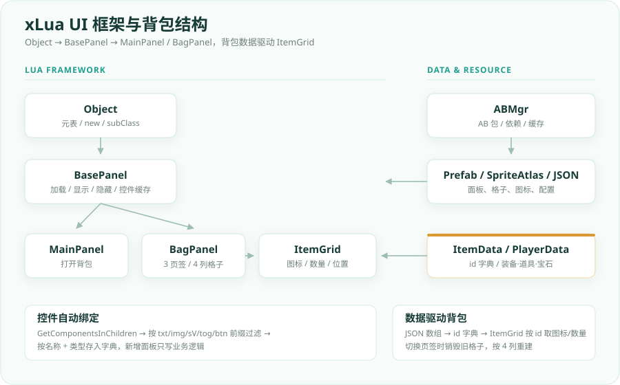

# Unity Portfolio

> Unity 客户端开发作品集：资源热更新、xLua UI 框架、UGUI 业务面板与玩法 Demo。

这个仓库用于集中展示我在 Unity 客户端方向的项目实践。内容以**项目说明、架构图、核心代码节选**为主，重点讲清楚“为什么这样做”和“代码怎么组织”，而不是堆截图。

在线作品集：`https://xssgg0522.github.io/unity-portfolio/`

> 说明：项目来自课程学习与个人复现，仓库中的文档、结构整理和部分修正由我完成。核心代码已移除 FTP 账号、服务器地址等敏感信息，仅保留实现思路。

---

## 项目一览

| 项目 | 方向 | 关键词 |
| --- | --- | --- |
| [AssetBundle 资源热更新系统](projects/ab-hot-update.md) | 资源管线 / 工具链 | AssetBundle、版本清单、MD5、FTP、异步下载 |
| [基于 xLua 的 UI 框架与背包系统](projects/xlua-bag.md) | UI 框架 / 数据驱动 | Lua 元表、BasePanel、控件自动绑定、SpriteAtlas |
| [坦克大战与 UGUI 选服面板](projects/more-demos.md) | 玩法 / UI | 面向对象、怪物 AI、UIManager、PlayerPrefs |
| [丧尸围城](projects/more-demos.md) | 3D 塔防 | NavMesh、波次、防御塔、JSON 配表 |

---

## 01 · AssetBundle 资源热更新系统

**解决的问题**：资源包从 Editor 发布到客户端更新，形成一条可复用的链路，而不是每次手动拷贝、手动对比。

**我做了什么**

- 用 `EditorWindow` 把平台切换、AB 版本清单生成、首包同步和 FTP 上传收敛到一个工具窗口
- 清单记录 `文件名 / 大小 / MD5`，作为客户端比对的唯一依据
- 客户端先拉远端清单，再读本地清单；首次安装回退到 `StreamingAssets`
- 按 MD5 生成新增 / 变更 / 待删除列表，只下载有差异的 AB 包
- 下载层用 `FTP + Task` 异步执行，带失败重试、进度回调和旧资源清理
- `Main` 入口串联“检测更新 → 下载 → 落地 → 进入游戏”，向 UI 暴露结果回调

**核心类**

- `ABUpdateManager`：客户端更新流程、清单解析、MD5 对比、下载调度
- `ABTools`：Editor 端清单生成、首包同步、FTP 上传
- `ABInfo`：AB 包元数据（名称、大小、MD5）

**详细说明**：[projects/ab-hot-update.md](projects/ab-hot-update.md)  
**代码节选**：[code-samples/ab-hot-update](code-samples/ab-hot-update)

---

## 02 · 基于 xLua 的 UI 框架与背包系统

**解决的问题**：把面板生命周期、控件绑定、Lua 脚本打包和背包数据驱动拆成可复用的层次，而不是每个面板重复写一套加载和查找逻辑。

**我做了什么**

- 基于 Lua 元表实现 `Object → BasePanel` 两级继承，统一面板加载、显示、隐藏
- 用 C# 反射 + `GetComponentsInChildren` 按 `txt/img/sV/tog/btn` 前缀自动扫描控件，并按名称、类型缓存
- 编写 XLua Editor 扩展，把 Lua 脚本批量转 `.txt` 并自动设置 AssetBundle 标签
- 背包配置从 AB 包加载 JSON，转成以 `id` 为键的字典，让配置和表现分离
- 背包按装备 / 道具 / 宝石拆成 3 个 Toggle 页签，切换时按 4 列重建 `ItemGrid`
- 图标名按 `_` 拆分后从 `SpriteAtlas` 取图，`MainPanel` 通过按钮打开背包

**核心类**

- `Object` / `BasePanel`：Lua 面向对象与面板生命周期
- `BagPanel` / `ItemGrid`：背包页签、格子创建、图标与数量
- `ItemData` / `PlayerData`：配置字典与玩家数据
- `LuaCopyEditor`：Lua → txt + AssetBundle 标签

**详细说明**：[projects/xlua-bag.md](projects/xlua-bag.md)  
**代码节选**：[code-samples/xlua-bag](code-samples/xlua-bag)

---

## 03 · 更多玩法 Demo

### 坦克大战与 UGUI 选服面板

- `TankBaseObj` 统一攻击、防御、血量和死亡逻辑，玩家 / 怪物子类重写开火与受伤
- 怪物 AI 使用随机路径点巡逻 + 射程 / 攻击间隔状态机
- 武器、子弹、奖励拆成独立对象，子弹按 Tag 区分敌我
- 泛型 `UIManager` + 字典缓存管理面板，`CanvasGroup` 做淡入淡出
- `GameDataMgr` 用 `PlayerPrefs` 保存音乐设置与 Top10 排行榜
- 另含 UGUI 选服面板：登录、注册、服务器选择、输入校验、本地记录持久化

### 丧尸围城

- 3D 塔防：选角 / 解锁英雄、选关卡、造塔点、3 种防御塔与升级链
- 怪物通过 `NavMeshAgent` 沿路径进攻中央安全区，按波次从多个出怪点刷新
- 主塔血量归零判负，所有波次清空且场上无怪物判胜
- `TowerObject` 支持单体 / 群体攻击，按射程和攻击间隔自动索敌
- 角色、场景、怪物、防御塔参数走 JSON 配置，玩家金币与解锁英雄持久化

**详细说明**：[projects/more-demos.md](projects/more-demos.md)

---

## 代码样例

| 目录 | 内容 |
| --- | --- |
| [code-samples/ab-hot-update](code-samples/ab-hot-update) | `ABUpdateManager`、`ABTools`、`Main` |
| [code-samples/xlua-bag](code-samples/xlua-bag) | `Object`、`BasePanel`、`BagPanel`、`ItemGrid` 等 Lua 脚本 |

代码样例说明：[code-samples/README.md](code-samples/README.md)

> 已做的整理：移除 FTP 账号 / 服务器地址、移除运行时脚本中的 `UnityEditor` 引用、修正 Android 平台宏拼写、补充关键注释。完整 Unity 工程因美术资源与课程版权未直接上传。

---

## 技术栈

`Unity 2022.3` · `C#` · `xLua / Lua` · `AssetBundle` · `UGUI` · `FTP` · `MD5` · `JSON` · `NavMesh` · `PlayerPrefs`

---

## 联系

- GitHub：[@xssgg0522](https://github.com/xssgg0522)
- 仓库：`https://github.com/xssgg0522/unity-portfolio`

> 在线作品集地址：`https://xssgg0522.github.io/unity-portfolio/`
