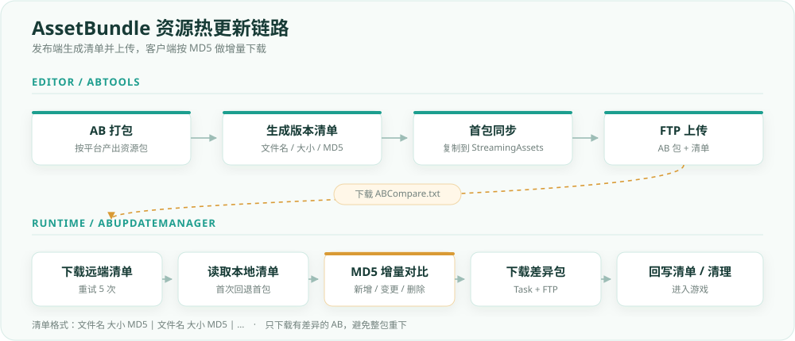

# AssetBundle 资源热更新系统

> 资源发布端 + 客户端更新端，形成从 AB 清单生成到差异下载的完整链路。

## 1. 背景

游戏资源如果每次都整包替换，包体会越来越大，更新成本也高。这个项目把资源拆成 AssetBundle，通过版本清单对比 MD5，只更新有变化的包。

**这是资源热更新，不是 C# 代码热更新**。当前 Demo 只负责把 AB 文件更新到本地，没有包含 AB 加载逻辑。

## 2. 整体链路

```text
Editor
  AB 包
   → 生成 ABCompare.txt（文件名 大小 MD5）
   → 首包复制到 StreamingAssets
   → AB 包 + 清单上传 FTP

Client
  启动
   → 下载远端 ABCompare.txt 到 ABCompare_TMP.txt
   → 解析远端清单
   → 读取本地清单（persistentDataPath，首次启动回退 StreamingAssets）
   → MD5 对比
   → 新增 / 变更包加入下载列表
   → 本地多余包删除
   → 逐个下载差异包
   → 全部成功后写回 ABCompareInfo.txt
   → 回调通知 Main / UI
```



## 3. 清单格式

`ABCompare.txt` 是自定义文本清单，不是 Unity 的 `AssetBundleManifest`：

```text
lua 1225 0a1b2c3d...
PC 1566 9f3c4d5e...
```

- `|` 分隔多个 AB
- 每个 AB 内部用空格分隔：`文件名 大小 MD5`
- `ABInfo` 负责保存 `name / size / md5`

> 局限：文件名不能包含空格；生产环境更适合 JSON，并增加版本号、文件哈希算法、依赖信息。

## 4. 核心类

| 类 / 方法 | 作用 |
| --- | --- |
| `ABUpdateManager.Instance` | 运行时单例，第一次访问时创建更新管理器 |
| `CheckUpdate` | 总流程：下载清单 → 读本地 → 对比 → 删旧 → 下载 → 写清单 |
| `DownLoadABCompare` | 下载远端清单，最多 5 次重试 |
| `GetRemoteABCompareFileInfo` | 解析清单文本为 `Dictionary<string, ABInfo>` |
| `GetLocalABCopmpareFileInfo` | 读取本地清单：`persistentDataPath` → `StreamingAssets` |
| `DownLoadABFile` | 下载待更新列表，最多 5 轮重试 |
| `DownLoadFile` | 用 `FtpWebRequest` 下载单个文件 |
| `ABInfo` | AB 元数据：名称、大小、MD5 |
| `ABTools` | EditorWindow：生成清单、首包同步、FTP 上传 |
| `Main` | 入口，调用 `CheckUpdate` 并接收回调 |

## 5. 对比逻辑

```text
遍历远端每个 AB：
  本地没有            → 新增 → 加入下载列表
  本地有，MD5 不同    → 变更 → 加入下载列表
  本地有，MD5 相同    → 跳过
  对比完，从 localABInfo 移除

远端遍历结束后：
  localABInfo 剩下的就是远端没有的旧包 → 删除
```

这个“移除已匹配项，剩下就是要删除的”写法，是这个项目里比较值得讲的一点。

## 6. 异步与 FTP

下载放在 `Task.Run` 里，避免 FTP / 文件 IO 阻塞 Unity 主线程：

```csharp
await Task.Run(() =>
{
    isOver = DownLoadFile(path1, path2);
});
```

- `Task`：.NET 的异步操作
- `Task.Run`：把委托放到线程池执行
- `await`：等待后台完成，但不阻塞主线程
- `async void`：调用者不能 await，结果通过回调返回

FTP 使用 `FtpWebRequest`：

- `Method = DownloadFile / UploadFile`
- `UseBinary = true`：AB 是二进制，必须避免文本模式换行转换
- `Credentials`：FTP 账号
- `Proxy = null`、`KeepAlive = false`：本地 FTP 环境更稳定
- 下载：`GetResponse()` → `GetResponseStream()`
- 上传：`GetRequestStream()` → 写入

## 7. 流式拷贝

```csharp
byte[] buffer = new byte[2048];
int len = downLoadStream.Read(buffer, 0, buffer.Length);

while (len != 0)
{
    file.Write(buffer, 0, len);
    len = downLoadStream.Read(buffer, 0, buffer.Length);
}
```

- `Read` 返回实际读到的字节数
- 返回 `0` 表示读完
- `Write` 只写 `len`，不能写 `buffer.Length`
- 使用 `using` 自动释放文件流

AB 可能几十 MB，不能用 `File.ReadAllBytes` 一次性读入内存。
